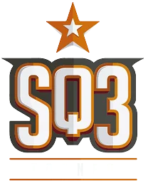

<div align="center">
  
  <h1>🏟️ Esquiu3 — Gestión Integral de Turnos & Analítica Predictiva (No-Show)</h1>
  <p><strong>Versión Beta del MVP · Evidencia de Aprendizaje Nº 3 · ISPC (Ciclo 2026)</strong></p>

  <p>
    <a href="https://esquiu-3.vercel.app"></a>
    <a href="https://www.python.org/"></a>
    <a href="https://fastapi.tiangolo.com/"></a>
    <a href="https://scikit-learn.org/"></a>
    <a href="#-suite-de-testing-y-qa-testeo-de-software"></a>
    <a href="#-modelo-de-machine-learning-práctica-profesionalizante-i"></a>
  </p>

  <p>
    🌐 <strong>Aplicación en Vivo:</strong> <a href="https://esquiu-3.vercel.app"><strong>https://esquiu-3.vercel.app</strong></a> &nbsp;·&nbsp;
    📚 <strong>Swagger UI:</strong> <a href="https://esquiu-3.vercel.app/docs"><strong>https://esquiu-3.vercel.app/docs</strong></a>
  </p>

  <p><em>Del cuaderno físico manuscrito a una arquitectura web predictiva en tiempo real para las 13 canchas del complejo Esquiu3.</em></p>
</div>

---

## 📌 Descripción del Proyecto

**Esquiu3** es una solución integral de software y ciencia de datos diseñada para erradicar los dos principales puntos de dolor operativos del complejo deportivo:

1. **Solapamientos y errores de registro manual:** Producto del uso histórico de un cuaderno manuscrito (que ocasionaba dobles turnos, fechas mal tipeadas con año `1900` y un `3%` de montos de seña omitidos o ilegibles).
2. **Pérdidas económicas por ausentismo (*No-Show*):** Alta tasa de cancelaciones tardías e inasistencias sin aviso en horarios pico nocturnos, agravadas por factores climáticos como lluvia o frío extremo.

El sistema digitaliza la operatoria de las **13 canchas** (Fútbol 5, Fútbol 7, Fútbol 11, Pádel, Tenis y Básquet) e integra en tiempo real un modelo **Random Forest Classifier** que evalúa cada reserva al instante, emitiendo un **semáforo de riesgo** y automatizando la exigencia de seña preventiva del 50% y el recordatorio por WhatsApp.

---

## ✨ Características Principales del MVP

* **🏠 Navegación Dual (Landing + Dashboard Operativo):**
  * **Landing Page Interactiva:** Hero animado con identidad visual `SQ3`, métricas de impacto, flujo operativo en 4 pasos y presentación del equipo con efectos *IntersectionObserver*.
  * **Dashboard MVP:** Estética cálida de alto contraste (`beige` + `naranja #E65C00`) pensada para uso intensivo en mostrador.
* **🚦 Semáforo Predictivo en Tiempo Real:**
  * 🟢 **Verde (< 35%):** Riesgo bajo — Confirmación estándar.
  * 🟡 **Amarillo (35% - 65%):** Riesgo moderado — Sugerencia de confirmación previa.
  * 🔴 **Rojo (> 65%):** Riesgo crítico de *No-Show* — Bloqueo preventivo hasta abonar **seña obligatoria del 50%** y generación de alerta automática para **WhatsApp**.
* **🌦️ Simulador de Clima Libre:** Permite evaluar cualquier escenario meteorológico (temperatura, humedad y condición climática) y explica en lenguaje claro su impacto sobre la probabilidad de asistencia, con *fallback* automático si el servicio externo no responde.
* **📅 Grilla Visual de 13 Canchas (14:00 a 23:00 hs):** Matriz horaria responsiva con encabezados *sticky*, scroll horizontal adaptado a monitores HD (`1366x768`) y bloqueo estricto contra solapamientos (`HTTP 409 Conflict`).
* **🛡️ Seguridad Activa y Auditoría (RBAC):**
  * Sanitización estricta contra inyecciones **XSS** (`html.escape`) y cabeceras de seguridad (`CSP`, `X-Frame-Options`, `X-Content-Type-Options`).
  * Control de acceso por roles (`X-Role: Admin` vs `Recepcionista`) para resguardar el panel de auditoría del cuaderno digitalizado y métricas del modelo (`HTTP 403 Forbidden`).

---

## 🧠 Modelo de Machine Learning (Práctica Profesionalizante I)

El pipeline (`train_model.py`) procesa el dataset digitalizado (`reservas_esquiu3.csv`), limpia anomalías históricas (filtrado de años `1900` e imputación de nulos por mediana según tipo de cancha) y entrena un `RandomForestClassifier` regularizado (`max_depth=5`, `class_weight='balanced'`), validado mediante **Repeated Stratified K-Fold (5 folds × 5 repeticiones = 25 iteraciones)**.

| Métrica / Indicador | Baseline (Evidencia 2) | MVP Beta (Evidencia 3 - CV 5x5) | MVP Beta (Hold-out) | Meta ISPC |
| :--- | :---: | :---: | :---: | :---: |
| **Recall (Clase No-Show)** | 72.00% | **91.07%** | **100.00%** | `> 72.0%` ✅ |
| **Accuracy Global** | 78.00% | **94.68%** | **96.00%** | `> 78.0%` ✅ |
| **Precisión (Ausentes)** | — | **88.67%** | **83.30%** | — |
| **Aporte Variables Climáticas** | Sin clima | **+14.27 pp en Recall** | — | Incorporado ✅ |
| **Latencia de Inferencia** | Notebook manual | **~12 ms** | **~12 ms** | `< 300 ms` ✅ |

---

## 🧪 Suite de Testing y QA (Testeo de Software)

El proyecto cuenta con una suite automatizada en `tests/test_esquiu3.py` con **16 pruebas ejecutadas y aprobadas al 100%**, cubriendo pruebas Funcionales, de Seguridad, de Usabilidad y de Regresión:

| ID | Categoría | Descripción del Caso de Prueba | Estado |
| :--- | :--- | :--- | :---: |
| **CF-01** | Funcional | Registro exitoso de reserva en cancha y horario disponible (`HTTP 200/201`). | ✅ Pass |
| **CF-02** | Funcional | Bloqueo estricto de reserva duplicada en misma cancha, fecha y hora (`HTTP 409`). | ✅ Pass |
| **CF-03** | Funcional / ML | Detección de riesgo **ALTO (Rojo)** en horario pico nocturno con clima adverso y exigencia de seña del 50%. | ✅ Pass |
| **CF-04** | Funcional / Bugfix | Predicción para cliente nuevo sin historial previo aplicando imputación por mediana (`Fix BUG-02`). | ✅ Pass |
| **CS-01** | Seguridad (RBAC) | Denegación de acceso (`HTTP 403 Forbidden`) al panel de auditoría para rol `Recepcionista`. | ✅ Pass |
| **CS-02** | Seguridad (XSS) | Sanitización de payloads `<script>alert('XSS')</script>` en notas del cuaderno (`Fix BUG-01`). | ✅ Pass |
| **CU-01** | Usabilidad | Consistencia visual y semántica en los umbrales del semáforo predictivo (Verde / Amarillo / Rojo). | ✅ Pass |
| **CU-02** | Rendimiento / UX | Tiempo de respuesta del endpoint de inferencia inferior a `300 ms` (medido: `~12 ms`). | ✅ Pass |
| **EX-01..04** | Regresión / Extra | Grilla de 13 canchas, fallback climático, scroll responsivo HD (`Fix BUG-03`) y simulador de clima libre. | ✅ Pass |

---

## 📁 Estructura del Repositorio

```text
Esquiu_3/
├── MUESTRA_DEFENSA/             # Carpeta principal para el coloquio de defensa
│   ├── GUIA_DEFENSA_COLOQUIO.md # Guía paso a paso para la defensa ante los profesores
│   ├── EDA_Esquiu3_ISPC.ipynb   # Cuaderno Jupyter pre-ejecutado con gráficos y métricas
│   ├── Evidencia3 de aprendizaje- Cocconi.docx # Informe formal ISPC para entrega
│   ├── Evidencia3 de aprendizaje- Cocconi.txt  # Respaldo en texto plano
│   ├── Evidencia3_de_aprendizaje_Grupo6.md     # Documento de entrega en Markdown
│   ├── iniciar_servidor_muestra.bat # Lanzador de un clic para web y navegador
│   ├── ejecutar_pruebas_qa.bat  # Lanzador de un clic para la suite de Pytest
│   ├── reservas_esquiu3.csv     # Dataset digitalizado con clientes al 50%
│   └── reporte_entrenamiento.json # Reporte JSON con métricas oficiales
├── docs/                        # Documentación académica formal (Word, TXT, MD)
│   ├── Evidencia3 de aprendizaje- Cocconi.docx
│   ├── Evidencia3 de aprendizaje- Cocconi.txt
│   └── Evidencia3_de_aprendizaje_Grupo6.md
├── notebooks/                   # Análisis Exploratorio de Datos (Jupyter Notebooks)
│   └── EDA_Esquiu3_ISPC.ipynb   # Pipeline CRISP-DM interactivo con gráficos
├── static/                      # Frontend SPA (Vanilla HTML5, CSS3, JS)
│   ├── index.html               # Landing page + Dashboard de canchas
│   ├── styles.css               # Sistema de diseño beige/naranja SQ3
│   ├── app.js                   # Lógica reactiva segura (defensa XSS)
│   ├── logo.png                 # Isologotipo oficial SQ3
│   └── favicon.png              # Icono de pestaña del navegador
├── tests/                       # Suite de QA Automatizada (Pytest)
│   ├── conftest.py              # Fixtures y TestClient para FastAPI
│   └── test_esquiu3.py          # Casos de prueba formales (Caja Negra, RBAC, UX)
├── api/                         # Configuración Serverless (Vercel)
│   └── index.py                 # Adaptador para FastAPI en la nube
├── main.py                      # Servidor FastAPI, endpoints REST y reglas de negocio
├── train_model.py               # Pipeline de Machine Learning (CRISP-DM)
├── modelo_esquiu3.joblib        # Artefacto binario entrenado (Random Forest)
├── reporte_entrenamiento.json   # Métricas oficiales de entrenamiento
├── reservas_esquiu3.csv         # Dataset digitalizado del cuaderno físico
├── requirements.txt             # Dependencias de producción y testing
├── pytest.ini                   # Configuración del ejecutor Pytest
├── vercel.json                  # Despliegue en Vercel
└── README.md                    # Documentación principal del repositorio
```

---

## 🚀 Instalación y Ejecución Rápida

### 1. Clonar el repositorio y crear el entorno virtual
```bash
git clone https://github.com/Fabricio-Cocconi/Esquiu_3.git
cd Esquiu_3
python -m venv venv

# En Windows:
venv\Scripts\activate

# En Linux/macOS:
source venv/bin/activate
```

### 2. Instalar dependencias
```bash
pip install -r requirements.txt
```

### 3. Entrenar el modelo predictivo *(Opcional, ya incluye `modelo_esquiu3.joblib`)*
```bash
python train_model.py
```

### 4. Iniciar el servidor FastAPI y abrir la aplicación
```bash
uvicorn main:app --reload --port 8000
```
- **🚀 Producción en Vivo (Vercel):** [https://esquiu-3.vercel.app](https://esquiu-3.vercel.app)
- **📚 Swagger UI en Producción:** [https://esquiu-3.vercel.app/docs](https://esquiu-3.vercel.app/docs)
- **💻 Entorno Local (Desarrollo):** [http://localhost:8000](http://localhost:8000/)

### 5. Ejecutar la suite de pruebas automatizadas (QA)
```bash
pytest -v
```

---

## 🔌 Endpoints Principales de la API

| Método | Endpoint | Descripción | Seguridad / Regla |
| :---: | :--- | :--- | :--- |
| `GET` | `/` | Sirve la interfaz web principal (Landing + Dashboard MVP). | Público |
| `POST` | `/api/v1/reservas/predict` | Evalúa el riesgo de No-Show y devuelve color de semáforo + acción preventiva. | Imputación para clientes nuevos |
| `POST` | `/api/v1/reservas` | Registra una reserva validando disponibilidad en las 13 canchas y adjunta predicción. | Anti-XSS + Bloqueo HTTP 409 |
| `GET` | `/api/v1/canchas/ocupacion` | Retorna la matriz horaria de ocupación de las 13 canchas por fecha. | Público / Operador |
| `GET` | `/api/v1/admin/metricas` | Expone la auditoría del cuaderno digitalizado y métricas del modelo ML. | Requiere header `X-Role: Admin` |

---

## 👥 Equipo Académico — Grupo Nº 6 (ISPC · 2026)

Trabajo desarrollado de forma articulada entre los espacios curriculares **Testeo de Software** y **Práctica Profesionalizante I** de la Tecnicatura Superior en Ciencia de Datos e Inteligencia Artificial y Tecnicatura Superior en Desarrollo de Software del **Instituto Superior Politécnico Córdoba (ISPC)**.

### Integrantes del Grupo Nº 6:
- **Yanina Roldan**
- **Gabriel Yoles Trucco**
- **Fabricio Cocconi**
- **Franco Gonzalo Arce**

### Docentes a cargo:
- **Testeo de Software:** Prof. David Cabrera · Prof. Carolina Ahumada
- **Práctica Profesionalizante I:** Prof. Daniela Accietto · Prof. Florencia García
